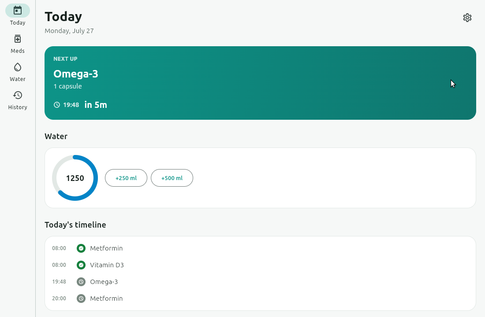
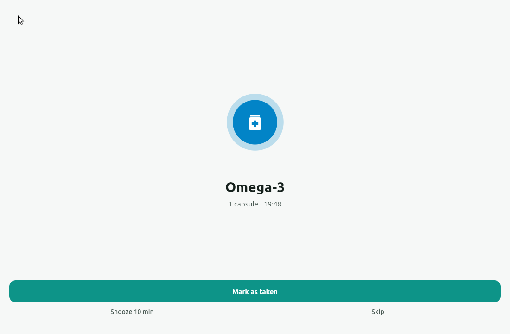
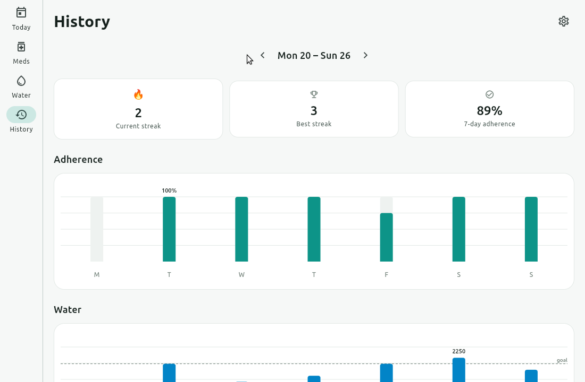
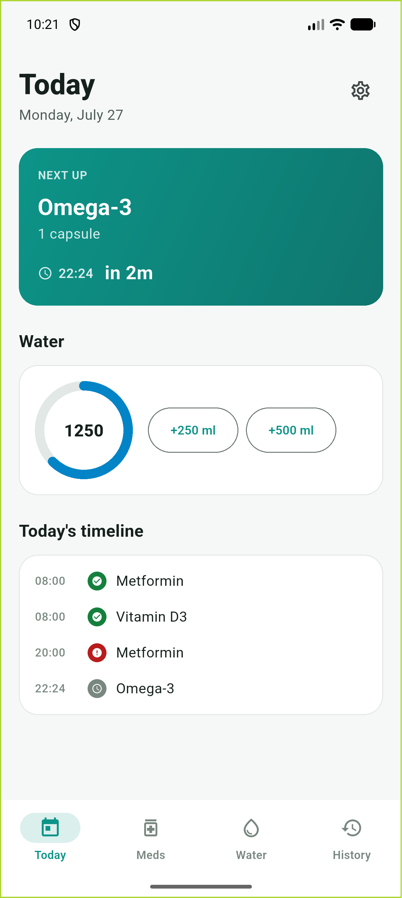
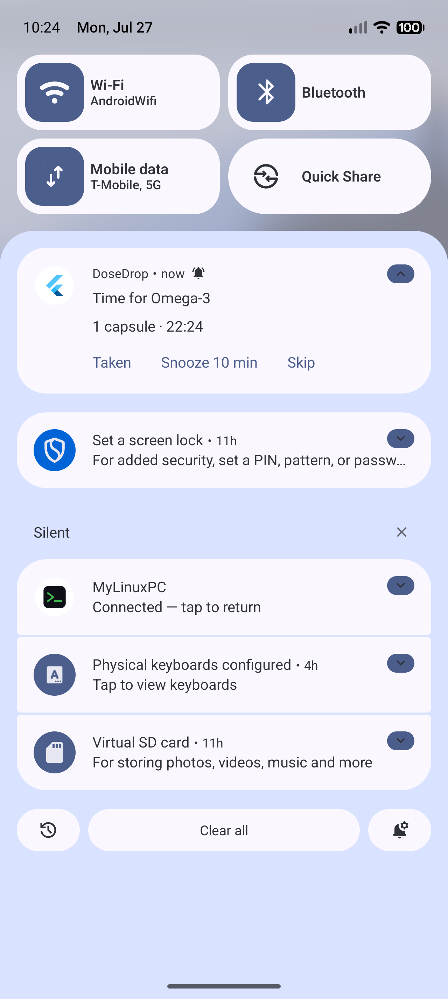
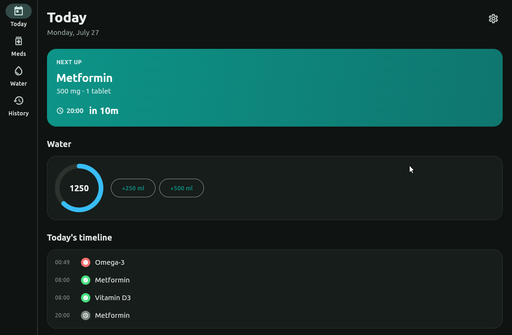

# DoseDrop

[](https://github.com/Dhiva-Labs/DoseDrop/actions/workflows/desktop.yml)


**Your tablets & water, on time.** · v1.0.0

DoseDrop is a medication and water reminder app that **nags until you confirm** — no
silent notification to swipe away and forget. Miss a dose and it escalates; go too long
without water and it asks. Every dose and every cup gets logged, so History shows exactly
how you're doing: streaks, weekly adherence, and a day-by-day breakdown.

Built with Flutter for **Android** and **Linux and Windows desktop**.

## Screenshots

| Today | Full-screen alarm | History |
|---|---|---|
|  |  |  |

| Android | Actions from the shade | Dark mode |
|---|---|---|
|  |  |  |

## Features

- **Medication reminders that escalate.** A dose alerts at its scheduled time, then
  re-alerts every few minutes (configurable) until you mark it taken, snooze it 10
  minutes, or skip it. Left too long, it's auto-marked missed.
- **Full-screen alarm.** Dose and water reminders can ring as a full-screen, hard-to-miss
  overlay, not just a notification you can dismiss without looking.
- **Water reminders** on an interval during your active hours, with a daily ml goal,
  one-tap quick-add logging, and undo.
- **History.** Current streak, best streak, 7-day adherence, and weekly bar charts for
  adherence and water intake. Tap any day for its full dose-by-dose breakdown.
- **Runs quietly.** Android pre-schedules reminders ~48 hours ahead and refreshes them on
  every app open; desktop lives in the system tray and can start at login.
- **Light, dark, or system theme**, with a med-color palette that's colorblind-checked.

## Platforms & how reminders actually behave

Reminders are the whole point of the app, so it's worth being precise about when they do
and don't fire.

**Android** — reminders fire even with the app fully closed, via scheduled exact alarms
and a boot-time rescheduler. Slots are pre-scheduled roughly 48 hours out and refreshed
on every app open and every action you take, so **open the app at least once every couple
of days** to keep the schedule topped up. Taken / Snooze / Skip work straight from the
notification shade, no need to open the app.

**Linux / Windows desktop** — DoseDrop lives in the system tray. Reminders fire on an
in-app timer while the process is running; closing the window docks it to the tray rather
than quitting, so reminders keep working. **Fully quitting from the tray menu stops all
reminders** until you reopen the app. Turn on "Start DoseDrop at login" in Settings if you
want it running automatically after boot. The tray menu has Open DoseDrop, Pause 1 hour,
and Quit.

## Download

Packages are attached to each [GitHub release](https://github.com/Dhiva-Labs/DoseDrop/releases/latest):

| Platform | x64 | arm64 |
|---|---|---|
| Debian / Ubuntu | `dosedrop_<version>-1_amd64.deb` | `dosedrop_<version>-1_arm64.deb` |
| Other Linux | `DoseDrop-<version>-linux-x64.tar.gz` | `DoseDrop-<version>-linux-arm64.tar.gz` |
| Windows | `DoseDrop-<version>-windows-x64.zip` | `DoseDrop-<version>-windows-arm64.zip` |
| Android | `DoseDrop-<version>.apk` | (same APK) |

The "Desktop builds" workflow builds the Linux and Windows packages for both
architectures and attaches them when a release is published (v1.0.0 has the
x64 Linux packages only). Every workflow run also keeps the tarballs, `.deb`s,
Windows zips, Microsoft Store `.msix` packages and snaps as run artifacts.

- **`.deb`:** `sudo apt install ./dosedrop_<version>-1_<arch>.deb` (pulls in the
  tray and sound dependencies), then launch **DoseDrop** from the app grid or
  run `dosedrop`.
- **Linux tarball:** extract it and run `./dose_drop` inside the
  `DoseDrop-<version>-linux-<arch>` folder. Needs `libayatana-appindicator3-1`
  and `aplay` (alsa-utils) at runtime.
- **Windows zip:** extract it and run `dose_drop.exe` inside the
  `DoseDrop-<version>-windows-<arch>` folder. Needs the Microsoft Visual C++
  Redistributable for the same architecture (ARM64 on Windows on Arm).
- **Snap:** `sudo snap install dosedrop` (strict confinement; see
  [packaging/SNAP.md](packaging/SNAP.md)).

## Building

Requires Flutter 3.44+. Flutter builds desktop apps only for the machine it
runs on, so an arm64 build needs an arm64 machine (an ARM64 Linux box or a
Windows on Arm PC); the output lands in `build/linux/<x64|arm64>/` and
`build\windows\<x64|arm64>\`.

### Android

```
flutter build apk --debug     # or --release
```

The manifest already declares `POST_NOTIFICATIONS` (13+) and the exact-alarm permissions,
and `android/app/build.gradle` already enables core library desugaring, which
`flutter_local_notifications` v22 requires.

### Linux

```
flutter build linux --debug   # or --release
```

The tray icon needs an AppIndicator development package on the build machine:

```
sudo apt install libayatana-appindicator3-dev
```

(or your distro's equivalent `appindicator3` dev package). If you're building with a
sandboxed/snap Flutter SDK, its bundled sysroot ships an older `glib` than the tray
plugin's `.so` expects to resolve at link time; `linux/runner/CMakeLists.txt` already
carries a workaround for this (`--unresolved-symbols=ignore-in-shared-libs`, since those
symbols are genuinely present on the host at runtime), so a plain `flutter build linux`
should just work regardless of which Flutter install produced the toolchain.

To package a release build (for the machine's architecture):

```
tools/build_tarball.sh   # dist/DoseDrop-<version>-linux-<x64|arm64>.tar.gz
tools/build_deb.sh       # dist/dosedrop_<version>-1_<amd64|arm64>.deb
```

### Windows

```bash
flutter build windows --release
pwsh tools/package_windows.ps1   # zip + Microsoft Store package (.msix), unsigned
```

`tools/package_windows.ps1` packages the build for the machine's architecture:
`dist/DoseDrop-<version>-windows-<x64|arm64>.zip` plus `dist/DoseDrop.msix` on
x64 or `dist/DoseDrop-arm64.msix` on ARM64 (it runs `dart run msix:create
--store --architecture <arch>`; a bare `msix:create` always assumes x64).
On Windows on Arm, Visual Studio needs the ARM64 C++ build tools and the ARM64
ATL component as well.

The build needs Visual Studio's C++ ATL component (flutter_local_notifications
includes `atlbase.h`). The unpackaged release build has been run on Windows 11:
window, tray icon and menu, close-to-tray, the alarm overlay and sound, and a
second launch bringing the running window back instead of starting another
copy. Data lives in `%APPDATA%\Dhiva Labs\DoseDrop`.

The Store package declares a startup task (`msix_config.startup_task`) for
"Start DoseDrop at login", because the HKCU Run key that unpackaged builds use
is virtualized inside MSIX, plus a COM toast activator for the notification
buttons. Those two only take effect in an installed package and have not been
exercised yet.

## Architecture

```
lib/
  main.dart              bootstrap: storage, notifications, tray, then runApp
  app.dart                MaterialApp + the NavigationBar/NavigationRail shell
  theme/                  design tokens (color, spacing, type) — one source of truth
  models/                 Medication, DoseRecord/DoseSlot, WaterEntry, settings, AppData
  services/
    schedule_engine.dart        pure Dart: slots, due/overdue, missed sweep, streaks
    storage_service.dart        atomic JSON file persistence
    notification_service.dart   flutter_local_notifications: schedule, actions, boot
    desktop_reminder_engine.dart  in-app timer scheduler (Linux/Windows)
    alarm_sound.dart            desktop alarm loop (aplay of a bundled wav)
    tray_service.dart           tray icon/menu + window management
    app_state.dart              ChangeNotifier — the one API the UI talks to
  screens/, widgets/       the UI
test/                      unit tests — schedule engine, storage, both reminder
                           engines; 127 tests, no Flutter dependency, run in
                           milliseconds
```

The schedule engine is deliberately framework-free: handed a list of medications, the
recorded history, and "now", it's pure functions the rest of the way — next dose, what's
due, what's overdue, streaks. That's what makes it fast to test and safe to reuse from
Android's background notification isolate, which resolves notification actions and logs
water straight to disk without ever spinning up the UI. `AppState` is the one seam
between that engine and the widgets: every mutation goes state → persist → reschedule
notifications → notify listeners, so screens never touch storage or the engine directly.

## Settings

| Setting | Default | What it does |
|---|---|---|
| Nag interval | 5 min | How often an unconfirmed dose re-alerts |
| Nag count | 3 | Re-alerts sent after the first notification |
| Grace window | 60 min | How long before an unconfirmed dose is auto-marked missed |
| Alarm sound | on | Loop a sound until you respond (desktop; Android uses the notification channel's sound) |
| Water goal | 2000 ml | Daily target, shown on the ring and the weekly chart |
| Cup size | 250 ml | Amount added by the primary quick-add button |
| Water interval | 60 min | Minutes between water reminders |
| Active hours | 08:00–22:00 | Window water reminders are allowed to fire in |
| Theme | System | System / Light / Dark |
| Autostart | off | Desktop only — launch DoseDrop at login |

## Limitations

- **Android, Linux and Windows are the supported platforms.** There's no iOS or macOS
  target.
- **Android is emulator-verified, not yet device-verified.** Scheduled notifications,
  shade actions and the background-isolate handler all work on a stock emulator; OEM
  battery optimizers (aggressive task killers) and reboot rescheduling on real phones
  haven't been exercised yet.
- **Desktop reminders need the app running.** Fully quitting from the tray stops
  reminders; there's no OS-level background service on Linux or Windows.
- **History reflects each medication's current schedule**, not a historical snapshot —
  editing a medication's time or days doesn't retroactively change how past days are
  displayed.

## Privacy

DoseDrop keeps all data on your device and makes no network connections. See
[PRIVACY.md](PRIVACY.md).
